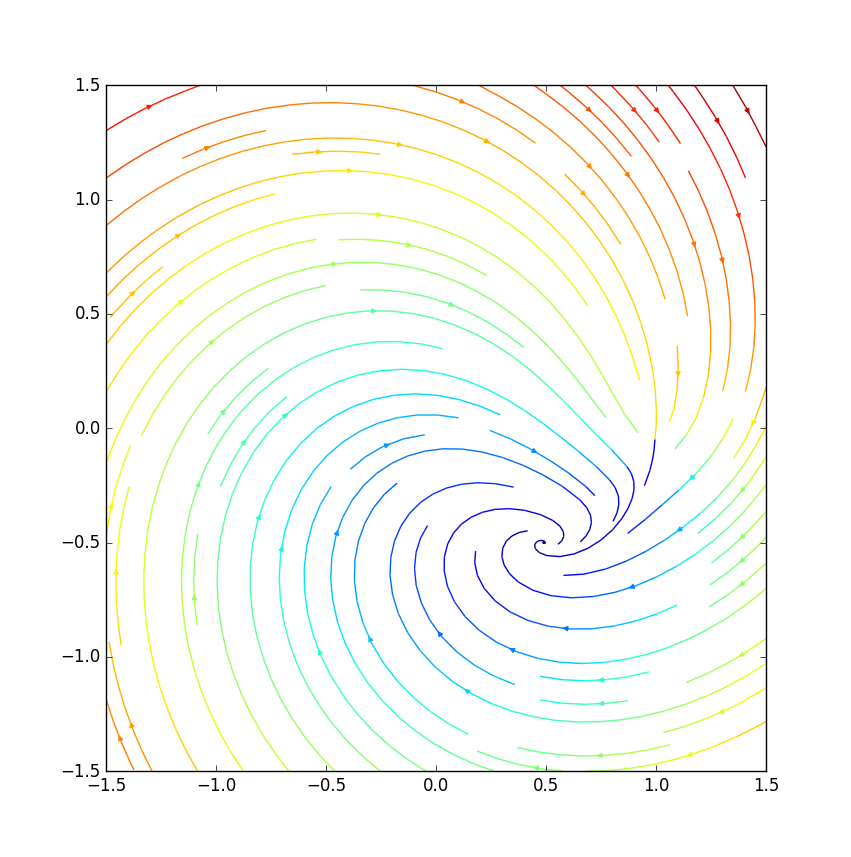
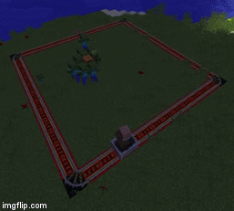

目标沿轨道不停兜圈，追赶者始终朝目标当前位置前进。如果追赶者速度较慢，肯定是追不上，这时会发生什么？

## 问题形式化

### 运动方程

设目标沿单位圆以角速度 \(\omega = 1\) 逆时针运动，追赶者速率为 \(v_{\max}\)（\(0 < v_{\max} < 1\)）。取随目标旋转的参考系，目标固定在 \(\mathbf{r}_0 = (1, 0)\)，追赶者位置为 \(\mathbf{r} = (x, y)\)，则

\[
\dot{\mathbf{r}} = -\boldsymbol{\omega} \times \mathbf{r} + v_{\max} \frac{\mathbf{r}_0 - \mathbf{r}}{\|\mathbf{r}_0 - \mathbf{r}\|},
\]

即

\[
\begin{aligned}
U &= y + v_{\max} \frac{1 - x}{\sqrt{(1 - x)^2 + y^2}}, \\
V &= -x - v_{\max} \frac{y}{\sqrt{(1 - x)^2 + y^2}},
\end{aligned}
\]

## 流场

取 \(v_{\max} = 0.7\)，用 Matplotlib 画流线：

```python
import numpy as np
import matplotlib.pyplot as plt

x = np.linspace(-1.5, 1.5, 300)
y = x
yT = np.array([y]).T
v1 = np.sqrt((1.0 - x)**2 + yT**2)
vmax = 0.7
U = yT + vmax * (1.0 - x) / v1
V = -x + vmax * -yT / v1
plt.streamplot(x, y, U, V, color=np.sqrt(U**2 + V**2))
plt.show()
```

颜色表示速度大小：



## 平衡点

令 \(U = V = 0\)，得：

\[
(x^*, y^*) = \left(v_{\max}^2,\ -v_{\max}\sqrt{1-v_{\max}^2}\right) \approx (0.49,\ -0.50).
\]

回到地面参考系，这个平衡点是半径为 \(v_{\max}\) 的圆轨道：追赶者以与目标相同的角速度运动，落后目标固定的相位角 \(\arccos v_{\max}\)。它追不上目标，却能在内圈跟上目标的节奏。

## Minecraft 中的例子

