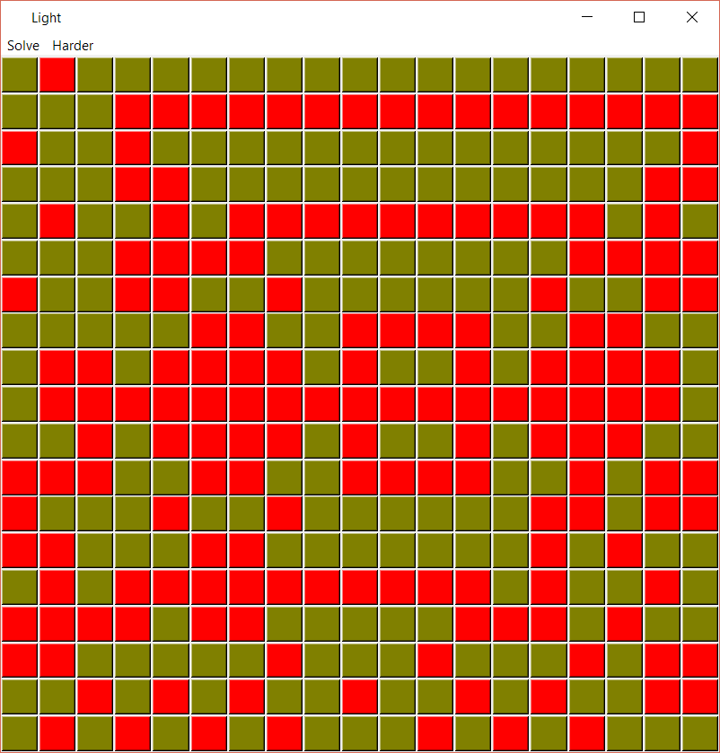

[Lights Out](https://en.wikipedia.org/wiki/Lights_Out_(game)) 是一个经典的点灯游戏：棋盘上每格是一盏灯，点击一格会翻转它自己和上下左右相邻格子的状态。目标是把所有灯都关掉。这个小项目是我写的求解器，带一个 Tkinter 界面，可以逐步增大棋盘，并给出需要点击的位置。



## 规则与异或

点击两次同一格等于没点，点击的先后顺序也不影响结果。所以每格只需要记“点了还是没点”，取值为 0 或 1。把灯的状态也记为 0/1，翻转就是模 2 加法，也就是异或。

设棋盘边长为 \(N\)，\(x_{ij}\in\{0,1\}\) 表示格子 \((i,j)\) 是否被点击，\(b_{ij}\) 是初始状态。要关掉所有灯，对每个格子有

\[
b_{ij} \oplus x_{ij} \oplus x_{i-1,j} \oplus x_{i+1,j} \oplus x_{i,j-1} \oplus x_{i,j+1} = 0,
\]

边界外的 \(x\) 视为 0。这是 \(\mathrm{GF}(2)\) 上含 \(N^2\) 个未知数、\(N^2\) 个方程的线性方程组。直接做高斯消元需要 \(O(N^6)\)，棋盘大一点就很慢。

## 逐行传播

利用游戏的结构可以大幅缩小问题。第 \(i\) 行格子 \((i,j)\) 的方程里，只有 \(x_{i+1,j}\) 属于下一行。因此一旦确定了前 \(i\) 行的点击，要想让第 \(i\) 行全灭，第 \(i+1\) 行的点击就被唯一确定：

\[
x_{i+1,j} = b_{ij} \oplus x_{ij} \oplus x_{i-1,j} \oplus x_{i,j-1} \oplus x_{i,j+1}.
\]

所以只要给定第一行的点击 \(x_{0,\cdot}\)，整个点击方案就按行传播出来，每行 \(O(N)\)，整盘 \(O(N^2)\)。前 \(N-1\) 行的方程自动满足，剩下的只有最后一行是否全灭。

## 缩成 N×N 系统

传播的每一步都是 GF(2) 上的线性运算，所以最后一行的残余状态可以写成

\[
r = r_0 \oplus T\,x_{0,\cdot},
\]

其中 \(r_0\) 是第一行点击全为 0 时传播得到的残余，\(T\) 是一个 \(N\times N\) 的 0/1 矩阵，只依赖 \(N\)。要求 \(r=0\)，即

\[
T\,x_{0,\cdot} = r_0 .
\]

这是 \(N\) 个未知数的线性方程组，高斯消元 \(O(N^3)\)。解出第一行后再传播一遍，就得到完整的点击图。如果方程组无解，说明这个局面没法全部关灯。

\(T\) 在代码里是这样得到的：以单位矩阵为起点，用同一个传播递推迭代 \(N\) 次，递推项只涉及相邻行与左右邻居的异或。

```python
rowA = np.zeros((self.size,self.size), dtype=np.bool)
rowB = np.eye(self.size, dtype=np.bool)
for _ in range(self.size):
    row = np.zeros_like(rowA, dtype=np.bool)
    row[   0,:] = rowB[   0,:] ^ rowB[  1,:]
    row[  -1,:] = rowB[  -1,:] ^ rowB[ -2,:]
    row[1:-1,:] = rowB[1:-1,:] ^ rowB[:-2,:] ^ rowB[2:,:]
    row = row ^ rowA
    rowA, rowB = rowB, row
self.transMat = rowB
```

传播本身先对一行做左右移位异或，随后结合灯的状态和上一行的影响，确定下一行点击：

```python
t = np.copy(row)
row[1:  ] = row[1:  ] ^ t[ :-1]
row[ :-1] = row[ :-1] ^ t[1:  ]
```

高斯消元部分以列操作的方式在 `transMat` 和右端 `row` 上同步进行，最后回代出第一行点击，无解时 `solve()` 返回 `None`。这部分比较绕，这里不展开，细节见源码。

## 界面

界面是 Tkinter 写的，棋盘是一个 `Button` 网格，默认边长为 5，窗口 800×800。顶部菜单只有两项：

- **Solve**：调用求解，把需要点击的格子标红；无解时弹出提示。
- **Harder**：棋盘边长加 1，重新生成一个全亮的棋盘。

初始棋盘每格都是“亮”，灯亮时显示橄榄色，灭时显示金色，所有格子变成金色即过关，会弹出祝贺窗口。

## 一些解的图案

下面是求解中发现的五张有结构的解图案。



## 源码

Python 2 脚本，依赖 Tkinter、NumPy 和 PIL。 [light-tkinter.py](light-tkinter.py)
